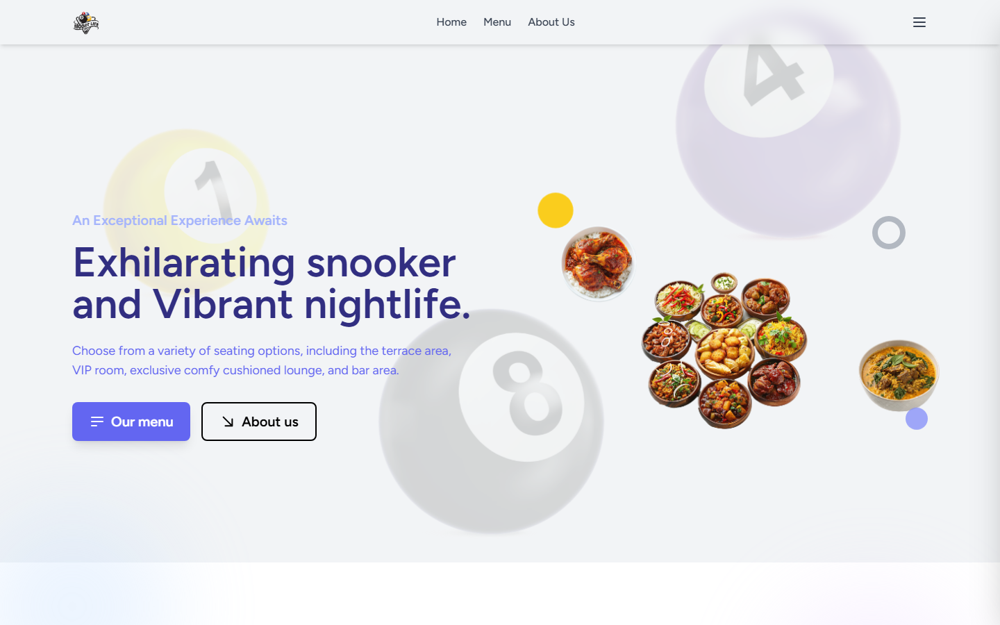
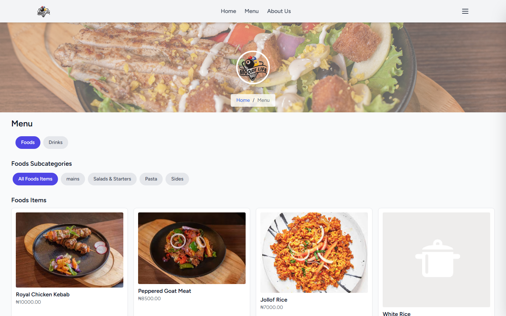
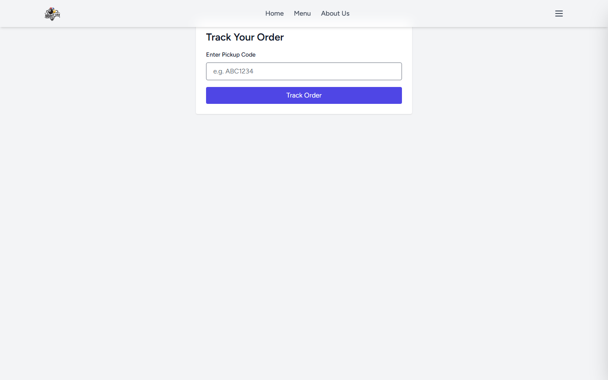
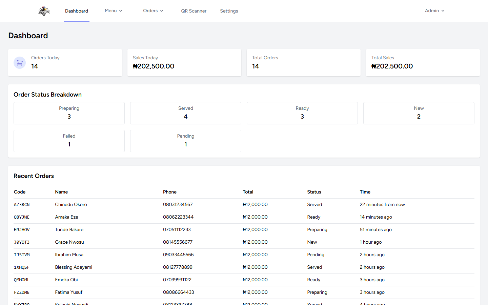
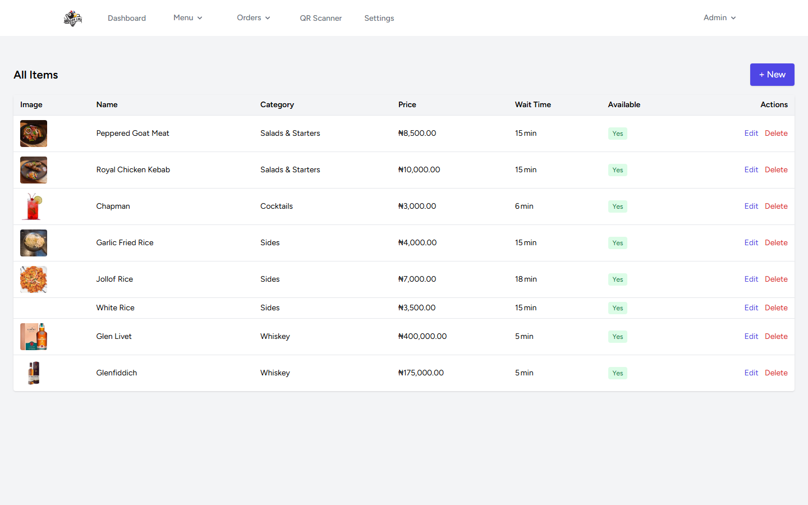
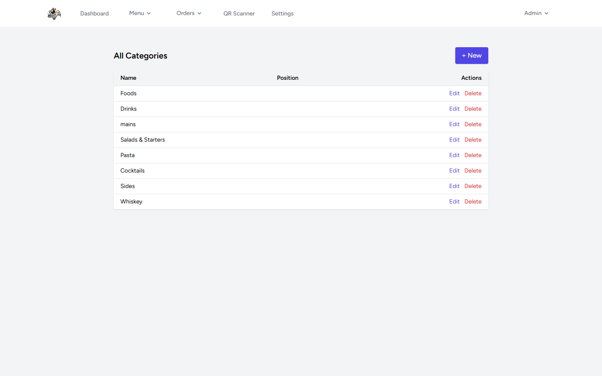
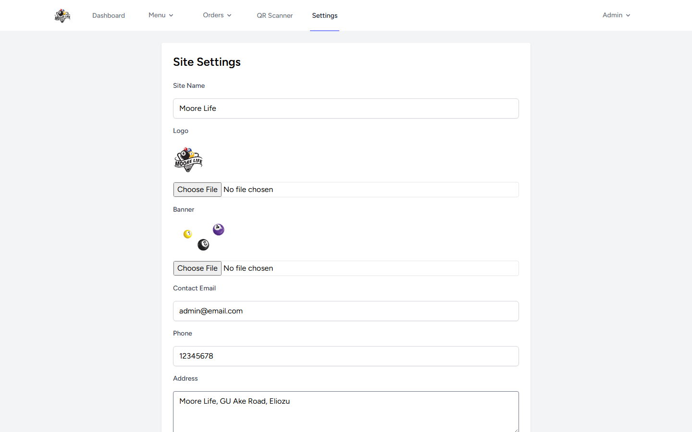

# Moore Life — Restaurant Ordering & Order Fulfilment

> A production restaurant ordering platform: a public menu and pre-order flow, Paystack payments with verification, pickup codes and QR-based fulfilment scanning, plus an admin console for menu, orders and business settings.

| | |
|---|---|
| **Role** | Solo — design, backend, frontend, payments, deployment |
| **Timeline** | 2026 |
| **Stack** | Laravel 10 · PHP 8.1+ · Blade · Alpine.js · Tailwind CSS 3 · Vite 5 · MySQL · Paystack · DomPDF |
| **Surface** | Customer storefront + admin back office + fulfilment scanner |

> **The source code for this project is private.** This repository is a technical case study with real screenshots from the running application.

---

## The problem

Small restaurants lose money in the gap between "order placed online" and "food handed over". The failure modes are mundane and expensive:

- Orders are taken by phone and written on paper, then lost
- Payment confirmation is manual, so staff serve food that was never paid for
- There is no reliable way to match a customer at the counter to their order
- The menu is a static PDF that nobody updates when an item runs out

This project closes those gaps with a straightforward model: **pay → verify → issue a pickup code → scan at handover**.

---

## Product tour

### Storefront



The landing page is the venue's identity — a snooker lounge and kitchen — with direct paths into the menu and the venue story.

### Menu and pre-order




The menu is data-driven: categories and sub-categories (Foods / Drinks, then mains, salads, pasta, sides, cocktails, whiskey) with per-item price, image and **preparation wait time**. Items can be hidden when unavailable instead of silently disappearing.

### Order tracking



Customers track an order by pickup code without an account — which is what makes it usable in a real queue.

### Admin console



The dashboard answers the questions an owner actually asks: orders today, sales today, total orders, total sales, and a **status breakdown** (pending → new → preparing → ready → served / failed). Failed payments stay visible instead of being quietly discarded.







Full CRUD for the menu, categories, and a single-row settings record controlling delivery fees, contact details and business preferences.

---

## How it works

```
Customer                    Application                     Kitchen / Counter
   │                            │                                   │
   ├─ browse menu ─────────────►│ categories + items (cached,        │
   │                            │ wait times, availability)          │
   ├─ add to cart ─────────────►│ session cart (no DB writes)        │
   ├─ checkout ────────────────►│ order created (status: pending) ──►│ appears on dashboard
   ├─ pay ─────────────────────►│ Paystack initialise                │
   │                            │   ├─ redirect verification         │
   │                            │   └─ webhook (server-to-server)    │
   │                            │ order verified → pickup code issued│
   ├─ track by code ───────────►│ status tracking                    │
   │                            │                                   │
   │                            │◄──── QR / code scan at handover ──┤
   │                            │ order marked served               │
```

### Design decisions

1. **Session-based cart.** A cart is temporary state. Keeping it in the session removes a table, a write on every tap, and a class of abandoned-cart garbage.
2. **Payment verification is a state machine, not a redirect.** Redirect confirmation is a hint; the webhook and a server-side verify call are the authority. An order only becomes valid when payment is verified.
3. **Pickup codes over accounts.** A random 6–7 character code gives customers order tracking with zero friction — no signup, no password reset, no "I used a different email".
4. **Server-rendered Blade + Alpine.** For a single-venue product, a small JS surface is a feature: fast first paint, no build-time complexity for the customer, and the admin screens remain simple to maintain.
5. **Wait time as data.** Each item carries a preparation estimate, so the promise made at checkout comes from the kitchen's own configuration rather than a guess.
6. **Admin prefix isolation.** All management routes live under `/admin` behind auth middleware, keeping the public and private surfaces cleanly separated.

---

## Feature set

**Customer**
- Categorised digital menu with images, prices and wait times
- Session cart with persistent state, pickup or delivery selection
- Paystack checkout with server-side verification
- Pickup code + public order tracking
- Responsive, mobile-first UI

**Operations**
- Admin dashboard: today's orders and sales, totals, status breakdown, recent orders
- Order list with status lifecycle and PDF export for accounting
- Menu item and category management, availability toggles
- QR/code scanner for fulfilment
- Single-source business settings (delivery fee, contact info, preferences)

---

## Status

Shipped and in use for a live venue. Known follow-ups (documented, not hidden): the admin order-detail route needs wiring to a detail view, and the camera-based scanner degrades to manual code entry on devices without camera permissions.

---

## Why this project is representative

This is a compact, complete product: a customer-facing flow, a payment integration that takes correctness seriously, an operations console, and a real deployment. It is also the project I use to explain how I scope: one venue, one problem, no speculative features — then ship it and iterate on what the staff actually complain about.
